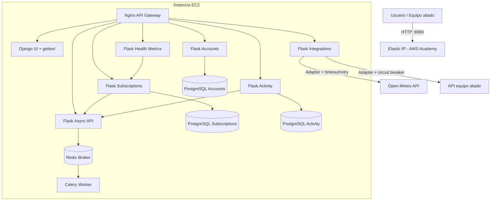
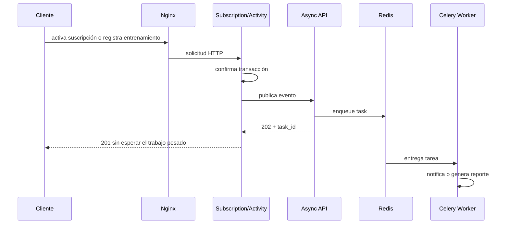

# Entrega 2 - Migración, integración y resiliencia

## 1. Trazabilidad con la rúbrica

| Criterio | Peso | Evidencia implementada | Validación |
| --- | ---: | --- | --- |
| Correcciones E1 | 10 % | Separación por capas conservada; validaciones, conflictos, pruebas y documentación reforzadas. La lista verbal del docente debe cerrarse en `CORRECCIONES-ENTREGA-1.md`. | `python manage.py test` y revisión del acta E1 |
| Arquitectura | 10 % | Diagrama actualizado con AWS, Nginx, Flask, tres PostgreSQL, Redis y Celery. | Este documento y `docker compose config` |
| Servicios | 30 % | API pública propia, consumo del aliado y Open-Meteo mediante puertos/adaptadores (DIP). | Endpoints `/api/v2/public`, `/ally` y `/weather` |
| Infraestructura | 30 % | Todo el ecosistema está empaquetado en Compose; Nginx es el único punto público. | Guía AWS y prueba de humo |
| Resiliencia y UX | 20 % | Reintentos, timeout, circuit breaker, health checks, Celery, Redis, UI accesible y gettext ES/EN. | Pruebas, cambio de idioma y caída controlada del aliado |

## 2. Arquitectura desplegada en AWS Academy

### Límites e independencia

- Cada dominio transaccional tiene su propio proceso y base de datos. No hay claves foráneas entre bases.
- La comunicación entre cuentas, suscripciones y métricas usa contratos HTTP, nunca imports de modelos.
- Nginx enruta por prefijo, añade cabeceras de trazabilidad, limita solicitudes y aplica timeouts.
- Solo Nginx pertenece a la red `frontend`; las bases y el broker no publican puertos al host.
- Una caída del sistema de notificaciones no revierte una suscripción o entrenamiento ya confirmado.

## 3. Strangler Pattern y exención del Parcial 02

### Línea base

La Entrega 1 exponía siete capacidades principales dentro de Django: usuarios, planes, suscripciones,
dispositivos, entrenamientos, métricas e integraciones/notificaciones. Antes de este cambio solo las métricas
tenían un servicio Flask; la migración efectiva era 1/7 (14,3 %).

### Estado objetivo verificable

| Capacidad | Ejecución actual | ¿Fuera del monolito? |
| --- | --- | --- |
| Registro/consulta de usuarios | `accounts_service` | Sí |
| Planes y suscripciones | `subscriptions_service` | Sí |
| Dispositivos | `activity_service` | Sí |
| Entrenamientos | `activity_service` | Sí |
| Métricas | `health_metrics_service` | Sí |
| Integraciones externa/aliada | `integration_service` | Sí |
| Notificaciones/reportes | `async_service` + worker Celery | Sí |

**Cálculo:** 7 capacidades migradas / 7 capacidades desplegadas x 100 = **100 %**.

Django conserva temporalmente el código histórico para mostrar la evolución del Strangler Pattern, pero
`gearpulse_project/urls.py` ya no registra rutas de negocio. Por tanto, el tráfico productivo de negocio se
ejecuta completamente en microservicios Flask funcionales e independientes.

## 4. Integración mediante Adapter e inversión de dependencias

`services/integration_service/ports.py` declara los contratos `WeatherPort` y `AllyPort`. La aplicación
depende de esos contratos. `OpenMeteoAdapter` traduce el JSON de Open-Meteo al vocabulario estable de
GearPulse; `AllyServiceAdapter` actúa como capa anticorrupción para el contrato del equipo aliado.

Ambos adaptadores configuran timeout y reintentos. El aliado añade un circuit breaker: después de tres fallos
evita nuevas llamadas durante 30 segundos y responde `503` sin tumbar la UI.

## 5. Comunicación asíncrona

Las tareas tienen serialización JSON, seguimiento de estado, límite de ejecución y reintentos con backoff.

## 6. i18n y usabilidad

- Todos los textos visibles de la plantilla están marcados con ``.
- El catálogo `locale/en/LC_MESSAGES/django.po` contiene la versión inglesa y se compila en la imagen.
- El selector estándar de Django guarda el idioma en una cookie firmada.
- Los formularios tienen etiquetas, tipos, rangos, autocompletado, foco visible y regiones `aria-live`.
- La UI es responsive, evita insertar HTML recibido y presenta estados de carga y degradación.

## 7. Decisiones de resiliencia

- Health checks en bases, Redis y cada servicio; Compose respeta dependencias saludables.
- Reinicio `unless-stopped` y volúmenes persistentes para datos.
- Respuestas de error estructuradas sin filtrar trazas internas.
- Timeouts de Nginx y clientes HTTP; retries solo para lecturas idempotentes.
- Tres bases separadas reducen acoplamiento y permiten evolución autónoma.
- Credenciales fuera de Git mediante `.env` y plantilla `.env.example`.

## 8. Limitación que requiere evidencia del equipo

El PDF condiciona toda la evaluación a implementar el 100 % de las correcciones comunicadas en la
sustentación de la Entrega 1. Esas observaciones no aparecen en el repositorio ni en el enunciado. Antes de
entregar, el equipo debe copiar la retroalimentación literal en `docs/CORRECCIONES-ENTREGA-1.md`, asociar
cada punto con un commit/prueba y obtener el visto bueno del docente o monitor.
